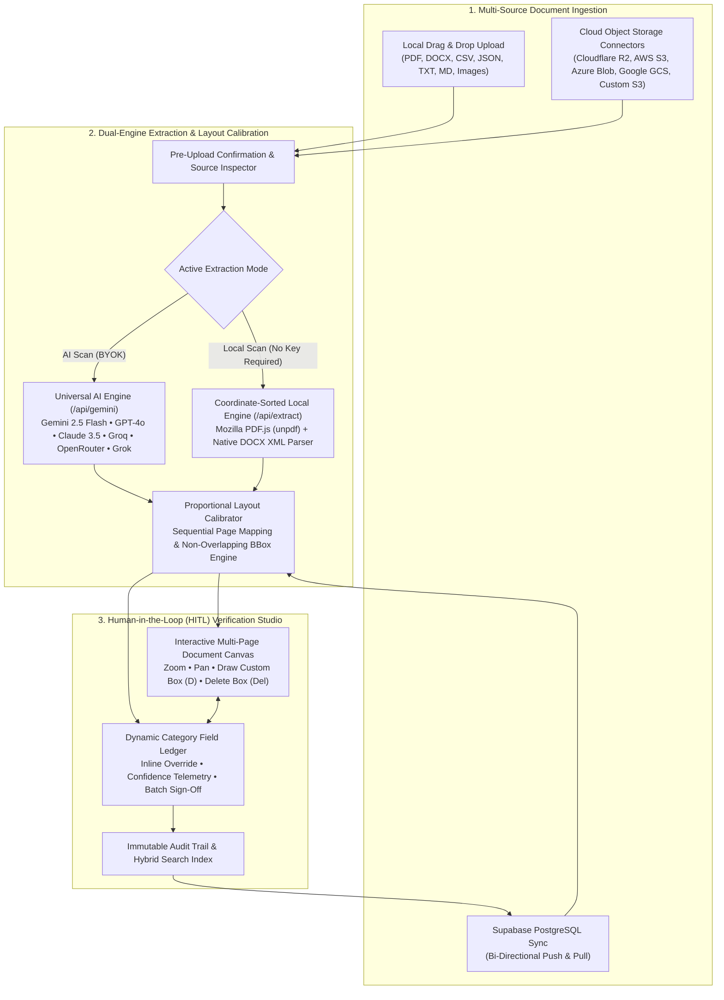

# AetherDoc Studio — Universal Document Intelligence & Human-in-the-Loop Verification Platform

<div align="center">

**Enterprise-Grade Multi-Format Document Extraction, Interactive Bounding-Box Auditing, Multi-Cloud Object Storage Ingestion, and Bi-Directional Supabase Sync**

[](https://nextjs.org/)
[](https://react.dev/)
[](https://www.typescriptlang.org/)
[](https://tailwindcss.com/)
[](https://supabase.com/)
[](https://github.com/keshav647)

</div>

---

## 1. Why We Need This Project

Organizations across finance, legal, healthcare, recruitment, and enterprise operations process thousands of unstructured documents daily—ranging from **commercial invoices** and **master service agreements (MSAs)** to **multi-page resumes/CVs**, **balance sheets**, **tax filings**, and **compliance audit statements**.

Traditional OCR and document extraction tools fail in modern workflows for four fundamental reasons:

1. **Rigid, Single-Domain Templates**: Legacy parsers are hardcoded for a single document type (e.g., only invoices with fixed `Subtotal` / `Tax` / `Total` fields). As soon as a team uploads a resume, legal contract, or medical record, hardcoded category schemas break down or misclassify critical data.
2. **Black-Box AI Hallucinations Without Visual Proof**: Pure LLM wrappers return raw JSON blobs without linking extracted values back to their exact visual coordinates on the page. Auditors have no way to verify *where* on Page 2 or Page 3 a figure came from, nor can they draw, resize, or delete bounding boxes when an extraction needs human correction.
3. **Cloud & Vendor Lock-In**: Most SaaS document platforms lock users into a single proprietary LLM and a single cloud storage silo, preventing teams from bringing their own API keys (**BYOK**) or pulling documents directly from their existing **Cloudflare R2**, **AWS S3**, **Azure Blob Storage**, **Google Cloud Storage**, or **Supabase PostgreSQL** infrastructure.
4. **No Offline / Zero-Key Fallback**: When an API quota is exhausted or a user wants to inspect sensitive documents locally without sending payloads to external AI providers, cloud-only tools become completely unusable.

---

## 2. What Problem AetherDoc Studio Solves

**AetherDoc Studio** bridges the gap between **autonomous AI document understanding** and **precision Human-in-the-Loop (HITL) visual verification**:

* **From Fixed Schemas to Dynamic AI-Driven Categorization**: Instead of forcing every document into rigid accounting buckets, AetherDoc Studio dynamically discovers and assigns context-aware section categories tailored to the actual document—such as *Contact & Identity*, *Education & Academic Background*, *Professional Experience*, and *Technical Skills* for a Resume, or *Line Items*, *Financial Totals*, and *Remittance & Compliance* for an Invoice.
* **Dual-Engine Architecture (Universal AI Scan + Offline Local Scan)**:
  * **AI Scan Mode**: Auto-detects any pasted API key (**Google Gemini**, **OpenAI GPT-4o**, **Anthropic Claude**, **Groq LPU**, **OpenRouter**, or **xAI Grok**) to extract structured fields, confidence scores, and page mappings from **any document or image format**.
  * **Local Engine Mode**: Works 100% key-free using coordinate-sorted **Mozilla PDF.js (`unpdf`)** and native **DOCX XML inflation** to parse `PDF`, `DOCX`, `CSV`, `JSON`, `TXT`, and `MD` files without external API calls.
* **Interactive Bounding-Box Verification Studio**: Renders every document page on an interactive canvas with content-proportional, non-overlapping bounding boxes. Reviewers can **click to inspect**, **edit values inline**, **draw new custom bounding boxes (`D`)**, **delete unwanted boxes (`Delete` / `Backspace`)**, and **approve/flag fields** with an immutable audit trail.
* **Direct Multi-Cloud Object Storage & Supabase PostgreSQL Integration**: Connect directly to **Cloudflare R2**, **AWS S3**, **Azure Blob Storage**, **Google Cloud Storage**, or **Custom S3 (MinIO / DigitalOcean Spaces)** using built-in **AWS Signature V4** and **Azure SAS** connectors, and synchronize documents bi-directionally with **Supabase PostgreSQL**.

---

## 3. System Architecture & End-to-End Workflow



---

## 4. Comprehensive Tech Stack Explanation

Every technology in **AetherDoc Studio** was selected to maximize extraction accuracy, visual responsiveness, and zero-lock-in extensibility:

### Frontend & Interactive Studio Layer
| Technology | Version | Why We Use It & Role in the Architecture |
| :--- | :--- | :--- |
| **Next.js (App Router)** | `15.1.0` | Provides unified React Server Components, client-side interactive studio routes (`/documents/[id]`), and serverless Node.js API endpoints (`/api/gemini`, `/api/storage`, `/api/extract`, `/api/export/[id]`) in a single cohesive runtime. |
| **React 19 (`useSyncExternalStore`)** | `19.0.0` | Powers the zero-latency reactive state store (`AppStoreManager`), synchronizing bounding box selections, inline field edits, and confidence telemetry across the canvas and ledger at 60 FPS without unnecessary re-renders. |
| **TypeScript** | `5.6.3` | Enforces end-to-end type safety across normalized bounding box coordinates (`NormalizedBBox`), multi-cloud storage configurations (`CloudStorageConfig`), extracted field schemas (`ExtractedField`), and audit logs (`AuditLog`). |
| **Tailwind CSS** | `3.4.16` | Implements the **Liquid Glass Design System**—combining deep obsidian surfaces (`#07090E`), translucent glassmorphic panels, tabular numeric telemetry (`tabular-nums`), and official cloud brand themes. |
| **Framer Motion & GSAP** | `11.15` / `3.15` | Drives smooth micro-interactions, modal transitions, bounding-box focus animations, and landing page choreography. |
| **Lucide React** | `0.468.0` | Supplies crisp, accessible vector iconography across the verification studio, cloud storage selectors, and telemetry cards. |

### Document Parsing, AI Orchestration & Cloud Infrastructure Layer
| Technology | Version | Why We Use It & Role in the Architecture |
| :--- | :--- | :--- |
| **Mozilla PDF.js (`unpdf`)** | `1.7.0` | Executes serverless coordinate-aware PDF text extraction in `/api/extract`. Groups text tokens by visual `(Y, X)` coordinates (`3.5pt` tolerance) so multi-column layouts, tables, and headers are reconstructed in natural human reading order. |
| **Native DOCX XML Inflator (`zlib`)** | Node Built-in | Parses `.docx` OpenXML archives directly in memory by locating and inflating `word/document.xml` without heavy external binary dependencies. |
| **Multi-LLM Universal Gateway (`/api/gemini`)** | Custom REST | Auto-detects API keys by prefix (`AIza...`, `sk-...`, `sk-ant-...`, `gsk_...`, `sk-or-...`, `xai-...`), dynamically queries Google's `/v1beta/models` endpoint to verify enabled Gemini Flash models, and includes automatic truncated-JSON recovery (`recoverTruncatedJson`). |
| **Zero-Dependency AWS Signature V4 Engine (`/api/storage`)** | Node `crypto` | Implements cryptographic `AWS4-HMAC-SHA256` request signing from scratch using Node's native `crypto` module, enabling direct `ListObjectsV2` and `GetObject` calls to **Cloudflare R2**, **AWS S3**, **Google Cloud Storage**, and **MinIO** without bloated SDK bundles. |
| **Supabase (`@supabase/supabase-js`)** | `2.47.10` | Provides cloud PostgreSQL persistence with Row Level Security (RLS), bi-directional document/field synchronization (`pull`, `push`, `both`), and dual-schema fallback compatibility. |

---

## 5. Key Features in Detail

### A. Dual-Engine Extraction (AI Scan vs. Local Scan)
- **Explicit Mode Selector in Studio Header**: Switch between **AI Scan** and **Local Scan** directly from the top toolbar of the Document Verification Studio.
- **Smart Pre-Flight Validation**: If **AI Scan** is selected without an active API key, the studio immediately opens the **AI Document Intelligence & API Key Setup** modal with a clear prompt rather than silently falling back.
- **Universal Provider Auto-Detection**: Paste any API key into a single input field—AetherDoc Studio automatically identifies **Google Gemini**, **OpenAI**, **Anthropic Claude**, **Groq Cloud LPU**, **OpenRouter**, or **xAI Grok**, tests the key live, and displays the verified model.

### B. Dynamic Multi-Page Layout & Bounding Box Studio
- **True Page-Count Calibration**: Respects the actual page count of uploaded documents (`1..N` populated pages) and eliminates empty trailing pages.
- **Content-Proportional Bounding Boxes**: Calculates vertical box heights proportionally to the text length of each extracted field so boxes never collide or clip multiline paragraphs.
- **Full CRUD on Bounding Boxes**:
  - **Add Custom Box (`D`)**: Click **Draw Custom Box** (or press `D`) and drag anywhere on the document canvas to create a new custom field with live coordinate binding.
  - **Delete Any Box (`Delete` / `Backspace`)**: Remove any custom or extracted field box directly from the floating bounding-box toolbar on the canvas, the trash icon on any Field Card in the right-hand ledger, or via keyboard shortcut (`Delete` / `Backspace`).
  - **Inline Override & Approval (`A` / `E` / `F`)**: Approve fields (`A`), edit values inline (`E`), flag anomalies (`F`), or batch-verify an entire document in one click.

### C. Branded Multi-Cloud Object Storage & Supabase Sync
- **Official Cloud Brand Themes**: Dedicated, color-calibrated storage connectors for:
  - **Cloudflare R2** (`#F38020` Cloudflare Orange)
  - **Amazon S3** (`#FF9900` AWS Amber Gold)
  - **Azure Blob Storage** (`#0078D4` Azure Blue)
  - **Google Cloud Storage** (`#4285F4` Google Royal Blue + 4-color accents)
  - **Custom S3 / MinIO / DigitalOcean Spaces** (`#8B5CF6` Violet)
- **Search & Import Before Ingestion**: Browse or search remote cloud buckets and Supabase PostgreSQL tables, inspect file metadata in the **Document Confirmation Modal**, and import documents directly into the verification queue.

---

## 6. Modular Codebase Structure

```text
├── app/
│   ├── (auth)/                 # Authentication & workspace onboarding flows
│   ├── (dashboard)/
│   │   ├── dashboard/          # Telemetry KPIs, Ingestion Dropzone & Verification Queue
│   │   ├── documents/          # Document Vault & Interactive HITL Verification Studio ([id])
│   │   ├── search/             # Hybrid Document, Field & Excerpt Search Engine
│   │   └── settings/           # Supabase Sync, Universal AI Key & Confidence Thresholds
│   └── api/
│       ├── extract/route.ts    # Coordinate-sorted PDF (unpdf) & DOCX server extraction
│       ├── gemini/route.ts     # Multi-LLM verification, model discovery & JSON extraction
│       ├── storage/route.ts    # AWS SigV4 (R2/S3/GCS/MinIO) & Azure Blob storage proxy
│       ├── search/route.ts     # Hybrid full-text & field search endpoint
│       └── export/[id]/route.ts# Audited JSON payload export endpoint
├── components/
│   ├── common/                 # CloudStorageModal, SupabaseSyncModal, ByokModal, DocumentConfirmModal
│   ├── dashboard/              # IngestionDropzone, TelemetryGrid, VerificationQueueTable
│   ├── landing/                # HeroSection, ArchitectureBento, ProductShowcase
│   ├── layout/                 # GlobalHeader, SidebarNav
│   └── studio/                 # StudioHeader, PdfCanvasViewer, DocumentPageRenderer,
│                               # BoundingBoxLayer, FieldLedger, FieldCard, AuditDrawer
├── lib/
│   ├── extraction/
│   │   ├── types.ts            # Core TypeScript interfaces & data contracts
│   │   ├── providerDetector.ts # API key sanitization & multi-LLM provider auto-detection
│   │   ├── layoutCalibrator.ts # Content-proportional bounding box & page layout engine
│   │   ├── localFileParsers.ts # Client/server PDF, DOCX, CSV, JSON, MD, TXT parsers
│   │   └── universalExtractor.ts # Unified AI + Local extraction orchestrator
│   ├── storage/
│   │   └── cloudProviders.ts   # Cloud provider brand tokens, MIME helpers & S3 URL builder
│   └── supabase/
│       ├── schema.sql          # Idempotent PostgreSQL schema + RLS policies
│       ├── client.ts           # Data store & Supabase client adapter
│       └── mock-data.ts        # Built-in evaluation documents & fields
├── store/
│   └── useAppStore.ts          # Reactive workspace store with localStorage & Supabase sync
└── supabase/
    └── schema.sql              # Production Supabase SQL migration script
```

---

## 7. Quickstart & Local Setup

### Prerequisites
- **Node.js** `>= 18.17.0`
- **npm** `>= 9.0.0`

### 1. Clone & Install Dependencies
```bash
git clone https://github.com/keshav647/aetherdoc-studio.git
cd aetherdoc-studio
npm install
```

### 2. Start the Development Server
```bash
npm run dev
```
Open [http://localhost:3000](http://localhost:3000) in your browser.

### 3. Optional: Connect AI API Key, Cloud Storage, or Supabase
- **Local Scan works immediately out of the box** with zero configuration for `PDF`, `DOCX`, `CSV`, `JSON`, `TXT`, and `MD` files.
- **To enable AI Scan**: Click **AI Engine** in the top header and paste a **Google Gemini** (`AIza...`), **OpenAI** (`sk-...`), **Anthropic Claude** (`sk-ant-...`), **Groq** (`gsk_...`), **OpenRouter** (`sk-or-...`), or **xAI Grok** (`xai-...`) key.
- **To enable Cloud Object Storage**: Click **Connect Cloud Storage** and select **Cloudflare R2**, **AWS S3**, **Azure Blob**, **Google Cloud Storage**, or **Custom S3**.
- **To enable Supabase Sync**: Click **Supabase Sync** in the header, copy the **Quickstart SQL Schema** (or run [`supabase/schema.sql`](supabase/schema.sql) in your Supabase SQL Editor), and enter your Project URL and Anon Public Key.

---

## 8. Author & Maintainer

* **Author / Contributor**: **keshav647**
* **Email**: [keshavbudhiraja4321@gmail.com](mailto:keshavbudhiraja4321@gmail.com)
* **GitHub**: [@keshav647](https://github.com/keshav647)
